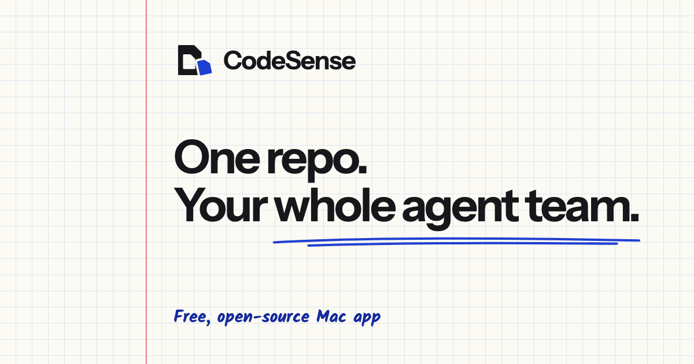

# CodeSense

<p align="center">
  
</p>

<p align="center">
  <a href="LICENSE"></a>
  <a href="https://github.com/codesensehq/codesense/releases"></a>
  
</p>

CodeSense is a Mac app that runs your team of Claude Code, Codex and OpenCode agents
across every repo, all in your own git. It gives each story its own worktree,
puts your team's context in each agent's worktree, and has an inbox where your
agents and you message each other.

> **Alpha, best effort.** CodeSense is early software maintained by one person.
> Expect rough edges and breaking changes between versions. Issues are triaged
> weekly, on a best-effort basis.

## Download

Download the DMG from [codesense.ai/download](https://codesense.ai/download),
open it and drag CodeSense to Applications.

The DMG is built, signed and notarized by the maintainer from the release's git
tag (`vX.Y.Z`). Builds are not yet reproducible.

The app checks for updates on its own and installs a newer, signed build when
you quit. See [PRIVACY.md](PRIVACY.md) for exactly what that check sends.

## Requirements

- A Mac with Apple Silicon. Tested on macOS 26 (Tahoe); older versions may work
  but aren't tested.
- An agent CLI to run, such as Claude Code, Codex or OpenCode, installed and signed in
  with your own account. CodeSense runs the CLIs; it makes no AI calls itself.
- git.

## Build from source

You need Node.js 24 (24.11 or a later 24.x), pnpm 10.16.1 (through `corepack enable`), the stable
Rust toolchain, `curl`, and the
[Tauri prerequisites](https://v2.tauri.app/start/prerequisites/) for macOS.

```bash
git clone https://github.com/codesensehq/codesense.git
cd codesense
corepack enable
pnpm install --frozen-lockfile
bash scripts/fetch-git-ai.sh     # the pinned, checksummed git-ai binary
pnpm build:emulator              # the terminal emulator worker
pnpm run tauri dev               # run it
pnpm tauri:build:unsigned        # or build a debug app, no signing or updater keys
```

A signed release build (`pnpm run tauri build`) needs your own Apple signing
identity and your own updater signing key; none are included here.

`scripts/fetch-git-ai.sh` downloads the pinned git-ai release over HTTPS, with
no GitHub login, and refuses it unless its SHA-256 matches `src-tauri/git-ai.pin`.
`bash scripts/fetch-git-ai.sh --dry-run` prints the URL it would fetch. If a step
fails on a clean checkout, please open an issue.

A build from source uses the `internal` update channel by default and leaves out
dashboard publishing. The DMG from codesense.ai/download includes dashboard
publishing; see [PRIVACY.md](PRIVACY.md) for the calls it makes. If you redistribute a
build, see [Building your own release](#building-your-own-release).

## Building your own release

If you give a build to other people, [TRADEMARKS.md](TRADEMARKS.md) asks you to
give it your own name, bundle identifier, update server and link scheme. These
are the settings to change. Line numbers are from the `main` branch at the time
of writing.

**Name and identity**

| Setting                                                                      | Where                                                 | Ours                                                                  |
| ---------------------------------------------------------------------------- | ----------------------------------------------------- | --------------------------------------------------------------------- |
| Product name (the app and `.app` bundle name)                                | `src-tauri/tauri.conf.json:3`                         | `CodeSense`                                                           |
| Window title                                                                 | `src-tauri/tauri.conf.json:15`                        | `CodeSense`                                                           |
| Bundle identifier (also names `~/Library/Application Support/ai.codesense/`) | `src-tauri/tauri.conf.json:5`                         | `ai.codesense`                                                        |
| App icons                                                                    | `src-tauri/tauri.conf.json:54-60`, `src-tauri/icons/` | see [TRADEMARKS.md](TRADEMARKS.md#files-the-mit-license-doesnt-cover) |
| Deep-link scheme (registered by the `beta` config only)                      | `src-tauri/tauri.beta.conf.json:5`                    | `codesense`                                                           |

**Updates and channel**

| Setting                                                                                     | Where                                                             | Ours                                           |
| ------------------------------------------------------------------------------------------- | ----------------------------------------------------------------- | ---------------------------------------------- |
| Build channel (`CODESENSE_CHANNEL`: `internal`, or `beta` with `CODESENSE_RELEASED_AT` set) | build environment, read at `src-tauri/build.rs:48`                | `internal` by default                          |
| Updater public key, built-in config                                                         | `src-tauri/tauri.conf.json:69`                                    | our minisign key                               |
| Updater endpoints                                                                           | `src-tauri/tauri.conf.json:70`                                    | `[]` (the app picks its update source itself)  |
| Updater public key, `beta` channel                                                          | `src-tauri/tauri.beta-prod.conf.json:7`                           | our production key                             |
| Download and update host, `beta` channel                                                    | `src-tauri/src/license/mod.rs:85`                                 | `dl.codesense.ai`                              |
| Update source for the `internal` channel (`CODESENSE_UPDATE_REPO`)                          | build environment, read at `src-tauri/src/commands/update.rs:113` | unset, so a source build makes no update check |
| Updater signing key (`TAURI_SIGNING_PRIVATE_KEY`, never in the repo)                        | build environment                                                 | use your own; it must match your public key    |

**Hosted services**

| Setting                                                                              | Where                                                                     | Ours           |
| ------------------------------------------------------------------------------------ | ------------------------------------------------------------------------- | -------------- |
| Public host, which the dashboard share host derives from (`share.<host>`)            | `src-tauri/build.rs:55`                                                   | `codesense.ai` |
| Dashboard sharing host (`CODESENSE_DASH_HOST`, with the `dashboard-publish` feature) | build environment, read at `src-tauri/src/dashboard_publish/client.rs:27` | unset          |

**Names stored on the user's Mac**

A build that keeps these shares data with an installed CodeSense on the same
Mac.

| Setting                                      | Where                                              | Ours                                             |
| -------------------------------------------- | -------------------------------------------------- | ------------------------------------------------ |
| App home folder                              | `src-tauri/src/commands/paths.rs:12`               | `~/.codesense`                                   |
| Keychain service, sign-in tokens             | `src-tauri/src/commands/credential_store.rs:21`    | `codesense-auth`                                 |
| Keychain service, SSH passphrases            | `src-tauri/src/commands/machines/passphrase.rs:15` | `codesense-ssh`                                  |
| Keychain service, dashboard publishing token | `src-tauri/src/dashboard_publish/client.rs:33`     | `ai.codesense.dashboards`                        |
| Keychain services, beta key                  | `src-tauri/src/license/static_channel.rs:33`       | `ai.codesense.beta`, `ai.codesense.beta-staging` |

**Signing.** Use your own Apple Developer ID and notarization credentials,
given to the Tauri build as its usual signing environment variables. Nothing in
the repository names ours.

## Project layout

- `src/`: the React frontend
- `src-tauri/`: the Rust backend and its workspace crates
- `src-emulator/`: the terminal emulator worker
- `codesense-docs/`: the product documentation shipped with the app
- `tests/`: end-to-end and conformance suites

## Questions and bugs

Report bugs in [GitHub issues](https://github.com/codesensehq/codesense/issues)
and ask questions in
[GitHub Discussions](https://github.com/codesensehq/codesense/discussions). See
[SUPPORT.md](SUPPORT.md) for where to ask what.

## Contributing

We don't accept pull requests yet: this repository is a release snapshot,
synced from private development. Issues and discussions are welcome. See
[CONTRIBUTING.md](CONTRIBUTING.md) for the policy and
[MAINTAINERS.md](MAINTAINERS.md) for who maintains CodeSense. Everyone taking
part follows the [Code of Conduct](CODE_OF_CONDUCT.md).

## Security

Please report vulnerabilities privately, as described in
[SECURITY.md](SECURITY.md). Don't open a public issue.

## Privacy

The app has no analytics or telemetry. [PRIVACY.md](PRIVACY.md) lists every
network call the app makes, and what the website counts.

## Licence

The code is under the [MIT licence](LICENSE). The CodeSense name and logo are
not covered by it: see [TRADEMARKS.md](TRADEMARKS.md).
